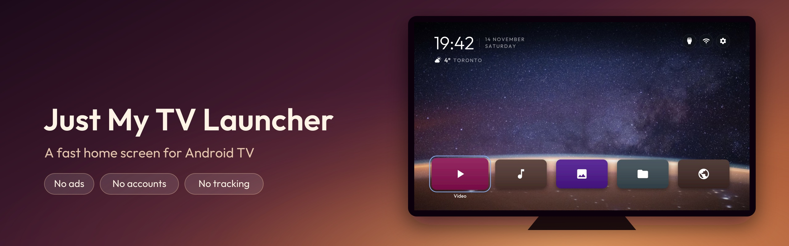
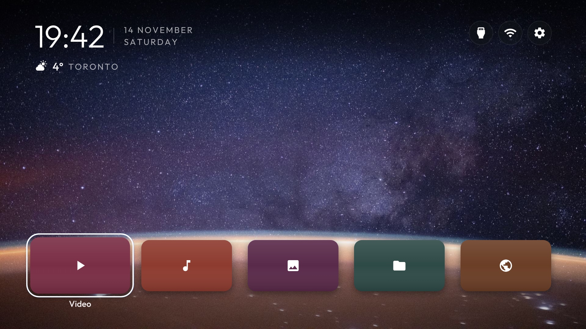
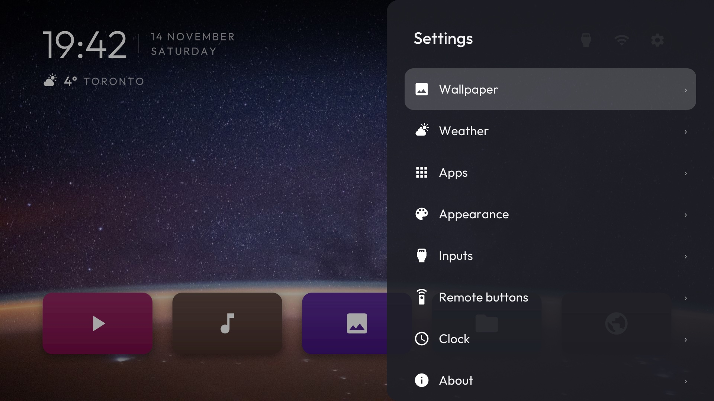

# Just My TV Launcher



A home screen for Android TV that opens fast and stays out of the way. It shows your apps as one grid with a bar at
the bottom, a clock, the weather, and a wallpaper that can be a picture, your own video loop, or streamed aerial
footage. There are no ads, no accounts and no tracking.

It was built for a TCL G03 (Android 11, 2 GB of RAM, a slow GPU), so it is written in plain Java with Android Views and
one Activity. The only libraries are AndroidX RecyclerView, DynamicAnimation and Media3 ExoPlayer.

## Status

The second alpha, 0.1.0-alpha.2, is on the [releases page](https://github.com/evg4b/just-my-tv-launcher/releases) with a
ready-built APK.

All planned features are written and build cleanly, and the 29 unit tests pass. The grid, the tile menu, settings,
inputs, weather, the wallpapers and the remote buttons service have been checked on the TV, the service with a
virtual keyboard rather than the real remote. The Russian screens have not, and a few video checks need someone
watching the screen. The on-device checks are listed as T16 to T19 in
[docs/OPEN-QUESTIONS.md](docs/OPEN-QUESTIONS.md).

## Features

- App grid. The first row is the bar and sits at the bottom of the screen, with the next row peeking up from below.
  Press Down to scroll the rest into view. Banners come from each app and are cached as WebP.
- Long OK on a tile opens a menu: Open, Move, Hide, App details. Order and hidden apps survive restarts, and new apps
  go to the end.
- Header with the clock, the date and the weather on the left, and icons for inputs, Wi-Fi and settings on the right.
- A settings panel that slides in from the right, operated entirely with the remote.
- Wallpapers: the built-in gradient, a picture, a new Unsplash photo every few minutes, a video file you choose, or
  Apple and Amazon aerials streamed from their servers. A video comes up from black (or its own first frame) and fades
  in once it plays, never over the gradient; aerials and photos fade through black from one to the next.
- Weather from [Open-Meteo](https://open-meteo.com), with no key and no location permission. You type a city once.
- An input switcher for HDMI and AV.
- Remote buttons: an optional accessibility service that opens an app of your choice when you press, say, the
  YouTube or NETFLIX button, from anywhere on the TV. A button can also be switched off or run a built-in action:
  Home, Back, the launcher's settings, TV settings pages, the power menu, Mute, Play / pause.
- English and Russian.

## Screens

The home screen with its default settings: the clock, the date and the weather at the top left, and one row of apps,
the bar, along the bottom. Press Down for the rest of the apps.



The settings panel slides in from the right over the home screen.



These pictures are rendered from the app's own layout sizes, colours, font and icons rather than taken as
screenshots; the app tiles are placeholders. The wallpaper is a NASA photograph from the International Space Station,
["A reddish airglow blankets Earth beneath the Milky Way"](https://commons.wikimedia.org/wiki/File:A_reddish_airglow_blankets_Earth_beneath_the_Milky_Way_%28iss073e0982696%29.jpg),
in the public domain; NASA does not endorse this project.

## Requirements

- Android TV 8.0 (API 26) or newer. Only Android 11 on the TCL G03 has been tested.
- Docker to build. The image brings JDK 17, Android SDK 36 and build tools 36.0.0, so nothing else is needed on the
  computer.
- `adb` to install it on the TV.

## Build

```bash
tools/docker-build.sh launcher assembleRelease
```

The APK lands in `launcher/app/build/outputs/apk/release/app-release.apk`. To run the unit tests and lint as well:

```bash
tools/docker-build.sh launcher testReleaseUnitTest lintRelease assembleRelease
```

The first build takes several minutes while it builds the image; later builds take about two. On Apple Silicon the
image runs as x86-64 under Rosetta, because the Linux AAPT2 exists only for that architecture.

The release APK is signed with a debug key. Android installs an update only if it is signed with the same key as the
app already on the TV, so build the same way every time. [tools/docker-build.md](tools/docker-build.md) explains how
to share one key between Docker and a native build.

## Install

Record the TV's current state first, so you can undo everything later:

```bash
TV_HOST=<tv ip> tools/record.sh
```

Then install and make it the home screen:

```bash
adb connect <tv ip>:5555
adb -s <tv ip>:5555 install -r launcher/app/build/outputs/apk/release/app-release.apk
adb -s <tv ip>:5555 shell cmd package set-home-activity com.evg4b.justmytv/.MainActivity
```

You can also press Home on the remote, pick Just My TV Launcher and choose "Always".

To go back to the launcher you had before, run:

```bash
TV_HOST=<tv ip> tools/restore.sh
```

It restores the home screen, the accessibility services and the enabled state of the recorded apps. It never removes
anything; uninstall Just My TV Launcher in Settings → Apps if you want it gone. [docs/OPERATIONS.md](docs/OPERATIONS.md)
has the details.

## Using it

The [user guide](docs/USER-GUIDE.md) covers navigation, every setting, how to prepare a video loop, and how to set up
the remote buttons.

## Network and privacy

Just My TV Launcher goes online in three cases only. When a city is set, it asks Open-Meteo for the current weather
every 30 minutes while the home screen is visible, sending the city's coordinates. When the Aerials wallpaper is
chosen, it streams clips from Apple and Amazon. When the Photos wallpaper is chosen, it asks Unsplash's API for a random photo with
your own access key and downloads it, at the interval you set and only while the home screen is visible. Nothing else leaves the TV: no
analytics, no crash reporting, no accounts.

The remote buttons service is an accessibility service, because that is the only way to catch a key press inside
other apps. It declares no event types and cannot read the screen; it looks only at key presses and acts on the
buttons you assigned. It stays off until you turn it on in the TV's accessibility settings.

## Repository layout

| Path | What it is |
|---|---|
| `launcher/` | The Android app (Gradle project) |
| `tools/` | Docker build, `tv.py` (ADB client and screenshots), `record.sh` and `restore.sh` |
| `docs/` | The plan, decisions, open questions, device facts, operations, and the user guide |

[docs/README.md](docs/README.md) lists every document.

## Licence and credits

Just My TV Launcher is released under the [Apache License 2.0](LICENSE). It includes or is based on:

- [CleanYourTV](https://github.com/Gathin23/cleanyourtv) (MIT, [LICENSE-CleanYourTV](LICENSE-CleanYourTV)): the
  grid and build tooling are based on it.
- [Material Icons](https://github.com/google/material-design-icons) and AndroidX Media3 (Apache 2.0).
- The [Outfit](https://github.com/Outfitio/Outfit-Fonts) font (SIL OFL 1.1,
  [launcher/app/FONT-LICENSE-OFL.txt](launcher/app/FONT-LICENSE-OFL.txt)).
- Weather data from [Open-Meteo](https://open-meteo.com) (CC BY 4.0).

[Couchy Launcher](https://github.com/conreo/couchy-launcher) (GPLv3) was a reference for the video wallpaper and the
settings panel. No code was copied from it, only ideas and values such as colours and timings. The aerial clips belong
to Apple and Amazon; the launcher only links to them. [launcher/app/NOTICE](launcher/app/NOTICE) lists the notices that
ship with the app.
